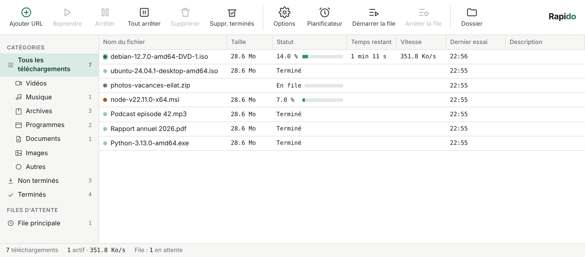
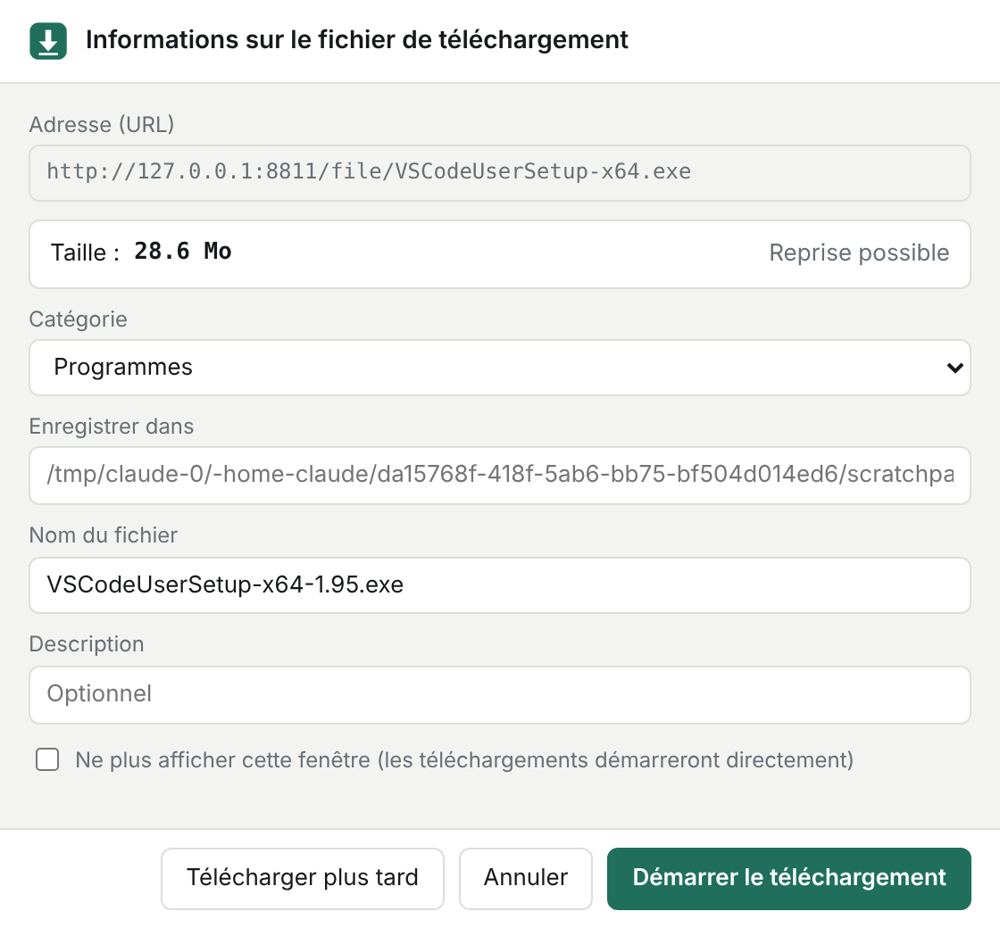
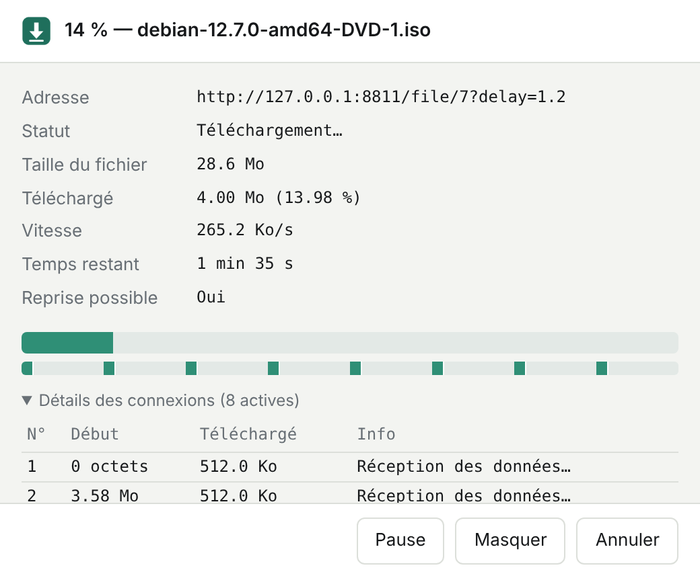

# Rapido

**A download accelerator for Windows**: multi-connection downloads, pause/resume that survives reboots, a scheduler, a video grabber and a Chrome extension that takes over your browser downloads.

Built with **Python (FastAPI + asyncio + httpx)**, a single-file HTML interface, and a Manifest V3 Chrome extension. The interface is in French.



| Capture dialog | Progress window |
|---|---|
|  |  |

## Features

- **Segmented downloading**: each file is split into up to 32 parts fetched in parallel with HTTP `Range` requests, written in place into a pre-allocated `.part` file.
- **Dynamic segmentation**: when a connection finishes early, the largest remaining segment is split in two and a new connection picks up the second half.
- **Robust resume**: per-segment progress is persisted to disk. Pause, network drops, crashes or a reboot all resume where they stopped. Retries use exponential backoff and are not counted as failures when the connection made progress.
- **Video grabber**: a "Download this video" button appears over videos in Chrome. Streams (HLS `.m3u8`, DASH `.mpd`, direct MP4) are detected by the extension and resolved with [yt-dlp](https://github.com/yt-dlp/yt-dlp), with a choice of quality (1080p, 720p, audio only…).
- **Browser integration**: the extension intercepts downloads matching your file types, forwards cookies and referrer (so logged-in downloads work), and falls back to Chrome if Rapido isn't running. Right-click menu included.
- **Capture → progress → done windows**: a file-info dialog before each download, a live progress window with per-connection details, and a completion dialog with "Open" / "Open folder".
- **Queue & scheduler**: "Download later", start/stop times, days of the week, then shut down, sleep or exit when the queue is finished (with a 60-second cancel window).
- **Clipboard monitoring**: copying a link to a file opens the capture dialog.
- **Global speed limiter**, automatic sorting by category, "refresh download address" for expired links (verified by file size), system tray icon.

## How it works

```
Chrome extension ──(JSON over localhost)──► FastAPI (127.0.0.1:9614) ──► engine.py
  · intercepts downloads                     · REST API                    · asyncio + httpx segment workers
  · sniffs media requests                    · serves the UI & dialogs     · yt-dlp in a worker thread
  · video overlay button                                                  · scheduler loop, clipboard thread
```

| File | Role |
|---|---|
| `engine.py` | Download engine: probing, segmentation, workers, persistence, yt-dlp, scheduler, clipboard |
| `desktop.py` | Windows app entry point: native windows, tray, single instance, self-test |
| `app.py` | FastAPI app, REST API, tray icon, autostart |
| `index.html` | Main window (toolbar, categories, sortable table, context menu, options) |
| `window.html` | Small dialogs: capture, video quality, progress, completed |
| `extension/` | Chrome extension (Manifest V3) |
| `packaging/` | Icon, Windows version info, Inno Setup installer script |

The API only listens on `127.0.0.1`, accepts cross-origin calls only from Chrome extensions, and requires `application/json` on every write, so a random website can't trigger downloads through a simple form post.

## Download

Get the latest **`Rapido-Setup-x.y.z.exe`** from the [Releases page](https://github.com/shimon3/rapido/releases/latest) and run it. It installs per user, so no administrator rights are needed, and adds Start-menu and desktop shortcuts, an uninstaller and an optional "start with Windows" setting.

> Windows SmartScreen may show *"Windows protected your PC"* because the app isn't code-signed: click **More info → Run anyway**.

A portable `.zip` is also attached to each release: unzip it and run `Rapido.exe`.

**Requirements:** Windows 10 or 11 (64-bit) with Microsoft Edge WebView2, which ships with up-to-date Windows. For HD video, Rapido can install **ffmpeg** for you: *Options → Outils → Installer ffmpeg*.

### Chrome extension

*Options → Outils → Installer l'extension Chrome…* opens the extension folder and `chrome://extensions`. Turn on **Developer mode**, click **Load unpacked** and select that folder. The icon toggles capture on and off.

### Desktop behaviour

- Rapido is a native Windows app (Edge WebView2 windows via [pywebview](https://pywebview.flowrl.com/)). It has no console and no browser tab.
- Closing the main window keeps Rapido running in the notification area, so downloads continue. Right-click the tray icon → **Quitter Rapido** to exit.
- Launching Rapido a second time brings the existing window to the front.

## Build from source

```bash
pip install -r requirements.txt pyinstaller
python desktop.py            # run the desktop app
python app.py                # or: server only, UI at http://localhost:9614
```

Windows builds are produced by [GitHub Actions](.github/workflows/windows.yml) on `windows-latest`:

1. PyInstaller builds `Rapido.exe` (one-folder, windowed, with icon and version info).
2. A self-test launches the real exe. It opens a WebView2 window, downloads a file through the engine, checks yt-dlp and opens a popup window.
3. Inno Setup builds the installer, and a portable zip is created.
4. Pushing a `v*` tag publishes a GitHub Release with both files.

## API

| Method | Route | Purpose |
|---|---|---|
| GET | `/api/state` | Downloads, queue state, pending power action |
| POST | `/api/downloads` | Add directly `{url, filename?, connections?, headers?, later?}` |
| POST | `/api/capture` · `/api/capture-video` | Create a pending download (opens the capture dialog) |
| POST | `/api/downloads/{id}/confirm` | Start or queue `{filename?, folder?, later, format_id?}` |
| POST | `/api/downloads/{id}/pause` · `/resume` · `/redownload` · `/refresh` | Control a download |
| POST | `/api/bulk/{pause\|resume\|delete\|clear-completed}` | Bulk actions |
| POST | `/api/queue/start` · `/api/queue/stop` | Queue control |
| GET / PUT | `/api/settings` | Settings, including the schedule |

## Limitations

- Servers that don't support `Range` requests fall back to a single connection, and a pause restarts that file from zero (shown as "no resume").
- DRM-protected streams (Netflix, Disney+…) are not supported.
- Signed links that expire may refuse to resume hours later: use *Refresh download address*.
- Shutdown / sleep actions and clipboard monitoring are Windows only.

## License

MIT. Downloading videos may be restricted by a site's terms of service: use it for content you are allowed to save.
